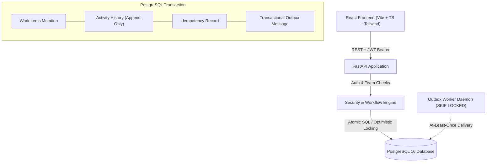

# Newtonite — Operations Under Pressure

Newtonite is a high-reliability, multi-team operations and work-item management platform engineered for environments operating under critical load. It implements server-side authorization, optimistic concurrency locking, conditional atomic claiming, PostgreSQL-backed idempotent requests, append-only transactional audit logs, and a transactional outbox queue.

---

## Architecture Overview



---

## Tech Stack & Prerequisites

- **Backend:** Python 3.12+, FastAPI, SQLAlchemy 2.x, Alembic, Pydantic v2
- **Database:** PostgreSQL 16+ (or local embedded PostgreSQL for zero-dependency test execution)
- **Security:** Bcrypt salted passwords, JWT HS256 signed bearer tokens
- **Frontend:** React 18, TypeScript, Vite, Tailwind CSS
- **Testing:** pytest, pytest-asyncio, HTTPX, Embedded PostgreSQL

---

## Environment Setup & Quickstart

### 1. Environment Configuration
Copy the sample environment variables:
```bash
cp .env.example .env
```

### 2. Backend Setup & Dependencies
Install python dependencies:
```bash
pip install -r requirements.txt
```

### 3. Database Initialization & Migrations
Run Alembic migrations to create tables and database constraints:
```bash
alembic upgrade head
```

### 4. Seed Demo Data
Populate teams, users with roles (`LEAD`, `MEMBER`, `VIEWER`), and demo work items:
```bash
python -m backend.scripts.seed
```

#### Demo Credentials
All seeded demo accounts share the password: `Password123!`

| Email | Name | Team | Role | Capabilities |
| :--- | :--- | :--- | :--- | :--- |
| `lead@newtonite.io` | Alice Ops Lead | Operations Core | `LEAD` | View, Create, Claim, Progress, **Approve** |
| `member@newtonite.io` | Bob Ops Member | Operations Core | `MEMBER` | View, Create, Claim, Progress |
| `viewer@newtonite.io` | Charlie Ops Viewer | Operations Core | `VIEWER` | Read-only access |
| `finlead@newtonite.io` | Diana Finance Lead | Financial Compliance | `LEAD` | Financial team lead actions (isolated team) |

---

## Application Startup

### Starting the Backend API
```bash
uvicorn backend.app.main:app --host 0.0.0.0 --port 8000 --reload
```
Interactive OpenAPI / Swagger documentation will be available at:
`http://localhost:8000/docs`

### Starting the Frontend Dashboard
In a separate terminal:
```bash
cd frontend
npm install
npm run dev
```
Open `http://localhost:5173` in your browser.

---

## Automated Test Execution

Run the complete integration and concurrency test suite against real PostgreSQL:
```bash
pytest tests/ -v
```

All 14 comprehensive test scenarios execute against real PostgreSQL, verifying:
1. Authentication and unauthenticated rejection (`401`)
2. Viewer permission enforcement (`403` on create/claim)
3. Lead-only approval enforcement (`403` when Member attempts approval)
4. Cross-team isolation and authorization boundaries
5. Workflow transition state machine validation (`422` on invalid leaps)
6. Valid Lead approval execution
7. Atomic concurrent claims on unassigned items (strictly 1 succeeds, other receives `409 Conflict`)
8. Stale optimistic locking version update rejection (`409 Conflict`)
9. Idempotent creation replay (returns identical resource without duplicating)
10. Concurrent racing requests using identical `Idempotency-Key` (zero duplicates)
11. Reusing an idempotency key with conflicting payload rejected (`409 Conflict`)
12. Atomicity verification: failed mutations leave no partial activity logs
13. Transactional audit log history generation
14. Transactional outbox persistence and idempotent worker execution
15. Server-side filtering, text search, and pagination

---

## Critical Engineering Behaviours

### 1. Atomic Claiming
Implemented using a conditional SQL `UPDATE` statement that atomically tests `assignee_id IS NULL` and `version = :version` in the database engine. If another claimant claims the record in parallel, `rowcount == 0` triggers an immediate rollback and returns `409 Conflict`.

### 2. Optimistic Locking
Every update to a work item verifies `version == :expected_version` and atomically increments `version = version + 1`. Stale concurrent updates fail fast with `409 Conflict` and return the latest version so clients can recover.

### 3. PostgreSQL-Backed Idempotency
`POST /items` supports an optional `Idempotency-Key` header scoped to `(user_id, operation, idempotency_key)` backed by a unique constraint. Replays return cached responses, tampered payloads yield `409 Conflict`, and simultaneous requests race safely.

### 4. Transactional Audit History
Every creation, status transition, assignment, and priority change appends an immutable `ActivityLog` in the exact same database transaction as the item mutation. Failures roll back both atomically.

### 5. Transactional Outbox Pattern
Async notifications are inserted into the `outbox_messages` table within the work item mutation transaction. The outbox processor uses PostgreSQL `FOR UPDATE SKIP LOCKED` to deliver jobs with bounded retries and exponential backoff.

---

## Known Limitations & Production Roadmap
- **Reopening Closed Items:** Closed items are terminal by design in the current workflow.
- **WebSocket Push:** The current UI uses optimistic recovery with on-demand reload buttons rather than real-time WebSocket subscriptions.
- **Outbox External Delivery:** Demonstrates deterministic dispatch; in production, connect to Amazon SES or Twilio SendGrid.
