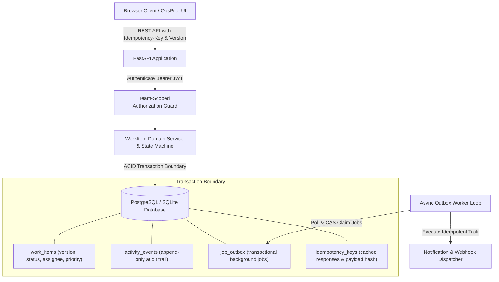

# OpsPilot — Operations Incident & Task Management Platform

OpsPilot is an operations management web application built to create, assign, track, and resolve high-stakes operational incidents, internal service requests, infrastructure tasks, and compliance follow-ups across specialized teams with strict concurrency control, transactional audit logging, and team-scoped authorization.

---

## Architecture Diagram



---

## Technology Stack

- **Backend Framework:** FastAPI (Python 3.11+, tested on 3.12 / 3.13)
- **Database ORM & Migrations:** SQLAlchemy 2.0 (AsyncIO), Alembic
- **Database Engine Support:** PostgreSQL 16 (`asyncpg`) & SQLite (`aiosqlite`)
- **Authentication & Security:** JWT (JSON Web Tokens via `python-jose`), Passlib & Bcrypt password hashing
- **Testing & Verification:** Pytest, pytest-asyncio, HTTPX AsyncClient
- **Frontend:** Vanilla JavaScript (ES6+), HTML5, Tailwind CSS CDN, Font Awesome

---

## Prerequisites
- **Option A (Docker & Docker Compose):** Docker Engine 24+ and Docker Compose v2+
- **Option B (Local Python):** Python 3.11+ (Python 3.12 recommended)

---

## Quickstart & Run Instructions

### Option 1: Running with Docker Compose (PostgreSQL)

```bash
# 1. Inspect or copy environment configuration
cp .env.example .env

# 2. Build and launch PostgreSQL, API, and Background Worker containers
docker compose up --build
```
The application will be live at: **http://localhost:8000**
API Interactive Swagger Documentation: **http://localhost:8000/docs**

To inspect background outbox worker logs in real time:
```bash
docker compose logs -f worker
```

To stop containers and preserve database volume:
```bash
docker compose down
```

---

### Option 2: Running Locally (Zero-Dependency SQLite)

```bash
# 1. Create and activate a Python virtual environment
python -m venv .venv
# On Windows PowerShell:
.\.venv\Scripts\Activate.ps1
# On macOS / Linux:
# source .venv/bin/activate

# 2. Install dependencies
pip install -r requirements.txt

# 3. Apply Alembic schema migrations
alembic upgrade head

# 4. Seed operational teams, accounts, and 1,500 realistic incident records
python -m app.scripts.seed

# 5. Start the OpsPilot API server
uvicorn app.main:app --host 0.0.0.0 --port 8000 --reload
```

Open **http://localhost:8000** in your browser to access the OpsPilot dashboard.

To launch the asynchronous Transactional Outbox background worker in a separate terminal:
```bash
python -m app.worker
```

---

## Database Migrations (Alembic)

OpsPilot uses **Alembic** configured for asynchronous SQLAlchemy. Migrations apply identically across PostgreSQL (`asyncpg`) and local SQLite (`aiosqlite`).

- Apply latest migrations: `alembic upgrade head`
- Inspect current revision: `alembic current`
- Generate new revision: `alembic revision --autogenerate -m "migration_name"`

---

## Demo Credentials & Team Access Control

All demo accounts use development-only credentials seeded by `app/scripts/seed.py`:

| User Email | Default Password | Team | Role | Permissions & Capabilities |
| :--- | :--- | :--- | :--- | :--- |
| **alex.lead@opspilot.dev** | `OpsPilotLead2026!` | Incident Response & Reliability | **LEAD** | Full CRUD, Claim, Approve, Close, Delete |
| **sam.member@opspilot.dev** | `OpsPilotMember2026!` | Incident Response & Reliability | **MEMBER** | Create, Claim, Update, Request Approval |
| **claire.viewer@opspilot.dev** | `OpsPilotViewer2026!` | Incident Response & Reliability | **VIEWER** | Strictly read-only item & timeline access |
| **dana.admin@opspilot.dev** | `OpsPilotAdmin2026!` | Incident Response & Reliability | **ADMIN** | Full administrative and lifecycle access |
| **eric.sre@opspilot.dev** | `OpsPilotLead2026!` | Cloud Infrastructure & SRE | **LEAD** | Lead in Cloud SRE (Forbidden in Incident Response) |
| **fiona.sre@opspilot.dev** | `OpsPilotMember2026!` | Cloud Infrastructure & SRE | **MEMBER** | Member in Cloud SRE |
| **george.sec@opspilot.dev** | `OpsPilotLead2026!` | Security & Compliance | **LEAD** | Lead in Security & Compliance |
| **hannah.sec@opspilot.dev** | `OpsPilotMember2026!` | Security & Compliance | **MEMBER** | Member in Security & Compliance |
| **ian.it@opspilot.dev** | `OpsPilotLead2026!` | Internal IT Operations | **LEAD** | Lead in IT Operations |
| **julia.it@opspilot.dev** | `OpsPilotMember2026!` | Internal IT Operations | **MEMBER** | Member in IT Operations |

> **Pro Tip:** In the OpsPilot UI, use the top-right **"Switch User"** dropdown to switch between Alex, Sam, Claire, Eric, George, and Ian with one click.

---

## How to Run Automated Tests

The test suite runs with **100% test isolation**. A session fixture in `tests/conftest.py` automatically provisions an ephemeral disposable test database, runs migrations and test seeds, and cleans up on teardown. The developer database is never touched or modified.

```bash
pytest -v
```

### Critical Engineered Behaviors Verified (28/28 Passing):
1. `tests/test_concurrency.py`: Parallel atomic claim race conditions (`200` vs `409 Conflict`) and stale update rejection with optimistic locking (`409 Conflict`).
2. `tests/test_idempotency.py`: Replayed `Idempotency-Key` network retries returning cached responses without duplicate rows, payload mismatch rejection (`400 Bad Request`), concurrent duplicate request race recovery on commit collisions, and cross-user key theft prevention (`403 Forbidden`).
3. `tests/test_edge_cases.py`: Cross-team data access isolation (`403 Forbidden`), Viewer write denial on create, claim, update, and comment (`403 Forbidden`), terminal status lifecycle protection (`CLOSED` immunity against transitions, claims, and edits), cross-team activity log isolation, and cross-team assignee validation (`400 Bad Request`).
4. `tests/test_outbox_and_pagination.py`: Server-side composite cursor pagination across 1,000+ items with deterministic tie-breaking `(created_at, id)`, bounded exponential retry backoff, attempt caps with terminal failure, duplicate processing idempotency across worker restarts, multi-worker safe claiming with compare-and-swap, and abandoned worker crash recovery.
5. `tests/test_work_items.py`: Workflow state machine with Lead approval constraints (`AWAITING_APPROVAL -> RESOLVED`), dedicated activity timeline endpoint, and item deletion authorization.
6. `tests/test_auth.py`: Token authentication, invalid credentials rejection, and team role memberships.
7. `tests/test_sanity.py`: Core system sanity, project metadata, and `/health` status check.

---

## Known Limitations
- **Real-time Push:** Client dashboard updates currently use server-side filtered refetch/polling rather than WebSockets or Server-Sent Events (SSE).
- **Outbox Side-Effect Boundary:** The transactional outbox guarantees durable at-least-once processing, bounded retries, and database deduplication. External notification dispatch (email/webhook) is simulated via structured logging; exactly-once delivery end-to-end requires downstream providers to support idempotency tokens.
- **SSO / Enterprise Auth:** SSO/SAML integration is omitted in favor of lightweight JWT token auth with seeded team roles.

---

## Troubleshooting

- **SQLite locking issues during rapid local testing:** The test suite uses temporary file paths in the OS temp directory (`Path(tempfile.gettempdir())`) with unique UUIDs and unlinks them on fixture teardown.
- **Port 8000 in use:** If port 8000 is occupied, set `PORT=8080` in `.env` or pass `--port 8080` to `uvicorn`.
- **Worker database connectivity:** The worker contains an active retry loop (`wait_for_database_ready`) that waits up to 60 seconds for the database and outbox schema before starting, preventing race conditions on container cold starts.

---

## Potential Future Improvements
1. **WebSocket / SSE Stream:** Replace HTTP polling with real-time Server-Sent Events push for collaborative board updates.
2. **Lead Reassignment Workflow:** Add explicit manager reassignment endpoints with justification comments and audit trails.
3. **Distributed Message Queue:** Transition outbox polling to Debezium Change Data Capture (CDC) streaming into RabbitMQ/BullMQ.
4. **File Attachments:** Add presigned S3/GCS URLs for incident diagnostic logs and screenshot uploads.
5. **SSO / Enterprise Auth:** Implement Google Workspace and Okta SAML 2.0 single sign-on.

See [ENGINEERING_DECISIONS.md](ENGINEERING_DECISIONS.md) for full context on architecture, design trade-offs, and scaling strategy.
